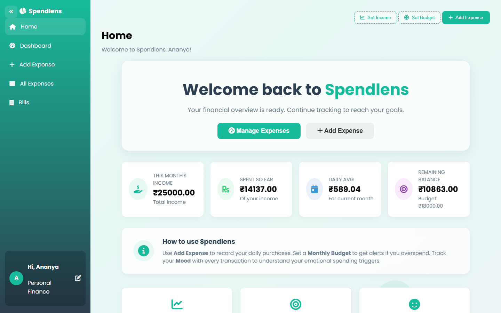
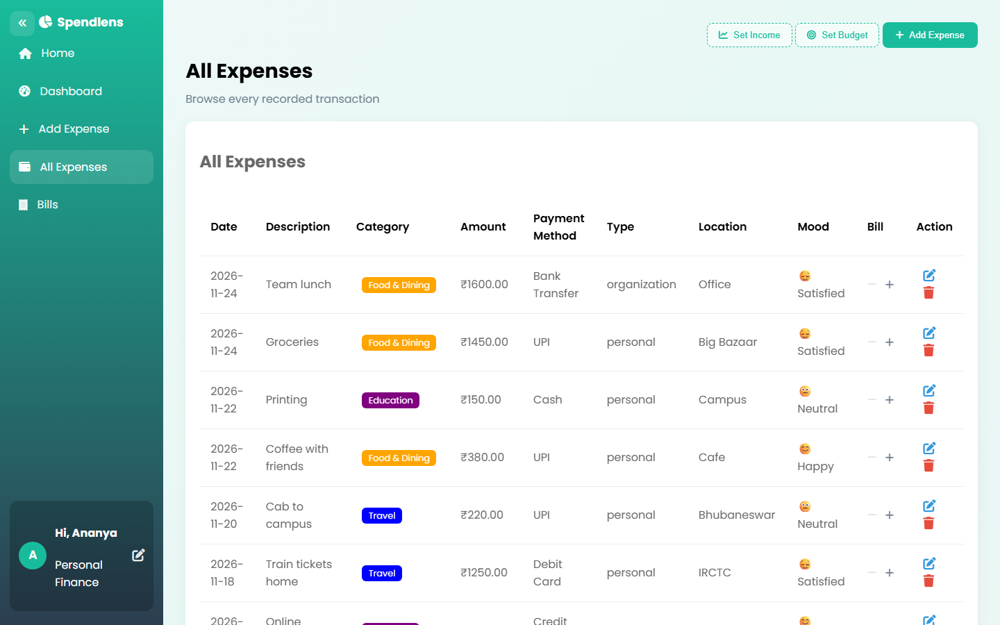
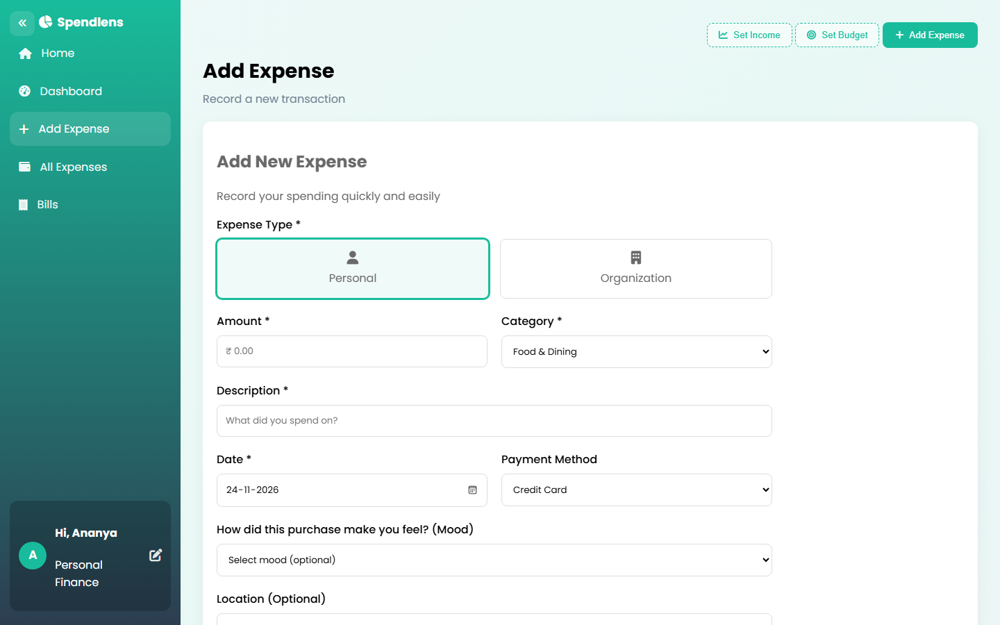
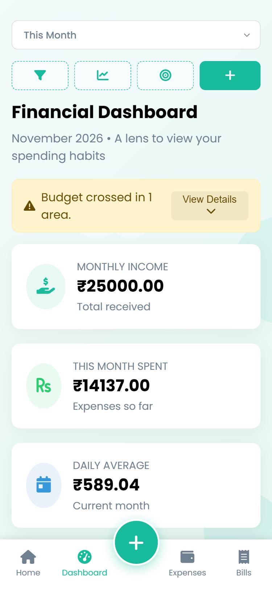

<div align="center">


# SpendLens

**A full-stack expense tracker you can install as an app (PWA), with budgets, income tracking, spending charts and bill photos.**

<!-- LIVE_DEMO_START -->
### [▶ Live demo](https://ananyaverma132005.github.io/spendlens/)
<sub>Runs fully in your browser with sample data. Changes are saved locally, and you can reset them anytime.</sub>
<!-- LIVE_DEMO_END -->

[](https://github.com/Ananyaverma132005/spendlens/actions/workflows/tests.yml)
[](LICENSE)


</div>

<p align="center">
  
</p>

---

## Overview

SpendLens helps you see where your money goes each month. You log expenses, set a monthly income and budget, and the dashboard shows what you've spent, your daily average and what's left, with charts of trends and categories. It's a Progressive Web App, so you can install it on a phone or desktop and use it like a native app.

## Features

- **Dashboard.** Monthly income, total spent, daily average and remaining balance at a glance.
- **Charts.** Daily spending trend and category breakdown, built with Chart.js.
- **Budgets and income.** Set a total and per-category budget each month. A banner flags any category that goes over.
- **Full expense management.** Add, edit and delete expenses with a category, payment method, location and mood, and filter them by type.
- **Upcoming payments.** Schedule one-off or repeating bills so they're not missed.
- **Bills and receipts.** Attach a photo of the bill to any expense.
- **Mobile-first and installable.** Responsive layout with bottom navigation. Installs as a PWA.
- **Validated REST API.** A Flask backend with JSON endpoints, input validation and an automated test suite.

## Screenshots

| Home | All expenses |
|---|---|
|  |  |

| Add expense | Mobile |
|---|---|
|  |  |

## Tech stack

| Layer | Technology |
|---|---|
| Backend | Python, Flask (REST API), Gunicorn |
| Database | SQLite |
| Frontend | HTML5, CSS3, vanilla JavaScript, Chart.js, Font Awesome |
| PWA | Web App Manifest, Service Worker |
| Quality | pytest (17 API tests), GitHub Actions CI on Python 3.10–3.12 |
| Hosting | GitHub Pages (live demo), Render (full stack, `render.yaml`) |

## Architecture

```
Browser (HTML/CSS/JS + Chart.js)
        │  fetch() JSON
        ▼
Flask REST API (app.py) ── validation ──►  SQLite (created from schema.sql)
```

### API endpoints

| Method | Endpoint | Purpose |
|---|---|---|
| GET | `/api/data` | Load expenses, payments, photos and settings |
| POST | `/api/settings` | Save income, budgets and user settings |
| POST / PUT / DELETE | `/api/expenses[/<id>]` | Create, update or delete an expense |
| POST / PUT / DELETE | `/api/payments[/<id>]` | Manage upcoming payments |
| POST / DELETE | `/api/photos[/<expense_id>]` | Attach or remove a bill photo |

Invalid requests return `400` with a clear message, for example `{"error": "amount must be greater than 0"}`. Requests for records that don't exist return `404`.

## Getting started

**Prerequisites:** Python 3.10+

```bash
git clone https://github.com/Ananyaverma132005/spendlens.git
cd spendlens

python -m venv venv
# Windows
venv\Scripts\activate
# macOS / Linux
source venv/bin/activate

pip install -r requirements.txt
python scripts/seed_demo.py   # optional: load sample data
python app.py
```

Open **http://127.0.0.1:5000**. The database is created automatically the first time you run the app. Tip: you can open a view directly with a link such as `/#dashboard`.

## Running tests

```bash
pip install -r requirements-dev.txt
pytest -v
```

The tests cover every endpoint, input validation and error cases. Each test runs against its own temporary database, and GitHub Actions runs the suite on every push.

## Deployment

**Live demo (GitHub Pages).** `.github/workflows/pages.yml` runs `scripts/build_static.py` on every push. The
build serves the same UI with `static/js/demo-api.js`, a browser-side version of the REST API (same endpoints,
validation and responses) backed by `localStorage`, so the demo works with no server.

**Full stack (Render).** The repo also includes a [Render](https://render.com) blueprint (`render.yaml`):

1. Sign in to Render with GitHub, then choose **New → Blueprint** and select this repository.
2. Render builds and starts the app on its free plan.

On the free plan the disk is temporary, so the live demo loads sample data each time it starts. For permanent storage, swap SQLite for a managed Postgres database.

## Project structure

```
spendlens/
├── app.py                  # Flask app, validation and REST API
├── schema.sql              # Database schema
├── scripts/seed_demo.py    # Sample data for demos
├── tests/                  # pytest suite
├── templates/index.html    # Single-page UI
├── static/
│   ├── css/style.css
│   ├── js/script.js        # Front-end logic and charts
│   ├── js/service-worker.js
│   ├── json/manifest.json  # PWA manifest
│   └── images/logo.png
├── docs/screenshots/
├── render.yaml             # Render deployment blueprint
└── .github/workflows/tests.yml
```

## Roadmap

- User accounts and authentication
- Export expenses to CSV and PDF
- Postgres support for production hosting

## Author

**Ananya Verma** · [GitHub](https://github.com/Ananyaverma132005) · [LinkedIn](https://linkedin.com/in/ananya-verma)

Licensed under the [MIT License](LICENSE).
