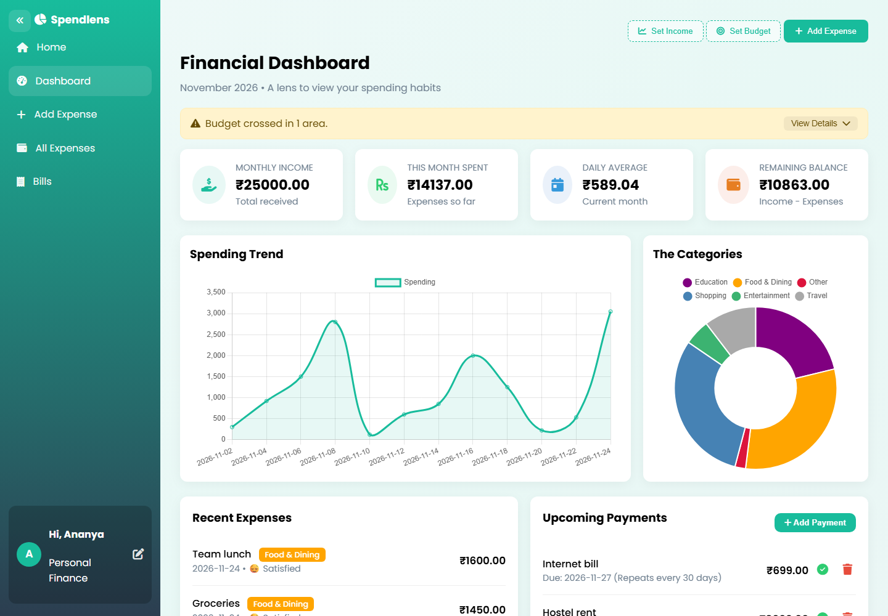

# SpendLens

An expense tracker web app. Log your expenses, set a monthly income and budget, and see where your money goes.



## Features

- Add, edit and delete expenses with category, payment method and mood
- Monthly income and budget, with a warning when a category goes over budget
- Spending trend and category charts
- Upcoming bill reminders and receipt photos
- Works on mobile and can be installed as an app (PWA)

## Tech stack

Python, Flask, SQLite, JavaScript, Chart.js, pytest

## Run locally

```bash
git clone https://github.com/Ananyaverma132005/spendlens.git
cd spendlens
pip install -r requirements.txt
python scripts/seed_demo.py   # optional sample data
python app.py
```

Open http://127.0.0.1:5000

Run the tests with `pip install -r requirements-dev.txt` and `pytest`.

## Live demo

https://ananyaverma132005.github.io/spendlens/
